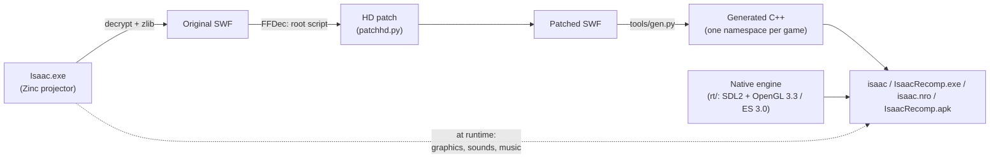

<p align="center">
  
</p>

<p align="center">
  
  
  
  
  
  
</p>

<p align="center">
  <b>The Binding of Isaac (Flash), rebuilt as a native program.</b><br>
  No Flash Player, no emulator: the same game you know, at 60 fps and in high resolution,<br>
  on PC, Android and Nintendo Switch.
</p>

> [!IMPORTANT]
> **This recomp was made by whylurking with the help of Artificial Intelligence.**
> It is a free, non-profit fan project with no affiliation to Edmund McMillen, Florian Himsl, Nicalis, Valve or Nintendo.
>
> **The game is not included.** To play, you need your own original copy from Steam:
> **[The Binding of Isaac](https://store.steampowered.com/app/113200/The_Binding_of_Isaac/)** and, for the expansion,
> **[Wrath of the Lamb](https://store.steampowered.com/app/113204/The_Binding_of_Isaac_Wrath_of_the_Lamb/)**.

---

## 😢 What is this?

*The Binding of Isaac* came out in 2011 as a Flash game. Flash is gone, and the Steam version still relies on an
old player that runs at 30 fps, in a small window, with the performance limits of its time.

This project **translates all of the game's original code into C++** and runs it on a modern, native engine
written from scratch. Graphics, sounds and music are **read from your own Steam `Isaac.exe`** at startup, so you
need the original game. What changes is *how* it runs, and *where*:

|                       | Original Flash                   | Recomp                                              |
|-----------------------|----------------------------------|-----------------------------------------------------|
| Frame rate            | 30 fps                           | **60 fps** (or whatever your display does: 120, 144…) |
| Resolution            | 800×600, upscaled                | **Native** (1080p, 1440p, 4K…)                      |
| Game logic            | 30 Hz                            | Exactly 30 Hz: same physics and patterns, checked frame by frame against the original |
| Performance           | Can stutter with many enemies    | Smooth, with drawing spread across CPU cores        |
| Controllers           | Needed JoyToKey                  | **Supported out of the box**, with analog movement  |
| Versions              | One per install                  | **Original, Wrath of the Lamb and Eternal Edition** in one program |
| Platforms             | Windows / Mac                    | **Windows, Linux, Android and Nintendo Switch (homebrew)** |

## 📥 Downloads

Everything is on the **[Releases](../../releases)** page. Pick the package for your device:

| Platform                  | File                          | Guide                                            |
|---------------------------|-------------------------------|--------------------------------------------------|
| Windows (64-bit)          | `IsaacRecomp_Win64.zip`       | [Installation (PC)](#-installation-pc)           |
| Linux (64-bit)            | `IsaacRecomp_Linux64.tar.gz`  | [Installation (PC)](#-installation-pc)           |
| Android (phone or tablet) | `IsaacRecomp.apk`             | [Android](#-android)                             |
| Nintendo Switch           | `IsaacRecomp_Switch.zip`      | [Nintendo Switch](#-nintendo-switch-homebrew)    |

On every platform you also need the game's `Isaac.exe` from your Steam copy (see
[Get the original game](#1-get-the-original-game)).

## 🕹️ Comparisons

### 30 fps → 60 fps

The logic still runs at 30 ticks per second, just like the original, so the game feels exactly the same. Every
in-between frame is drawn by interpolating between the last two ticks: movement, animations, fades and room
transitions all play at your display's refresh rate.

<p align="center">
  <br>
  <sub>Shown in slow motion (×0.5) so the difference is visible on any screen.
  <a href="https://github.com/user-attachments/assets/cd45b188-6449-4ee5-8da7-b818399a5756">Real-time 60 fps video</a>.</sub>
</p>

### Real high resolution

Vector art is rasterized at your screen's actual resolution, and the layers the game used to paint at 640×480
(floor, blood, shadows, minimap) are generated at 1440×1080.

<p align="center">
  
</p>

### All three Steam versions

If you have more than one version of the game, the program recognizes each one by its content and lets you pick
at startup. Each version keeps its own save file.

<p align="center">
  
</p>

<p align="center">
  
</p>

## ✨ What's new compared to the original

- **60 fps or more**, with the game logic untouched at 30 Hz.
- **Native 1080p / 4K**, with no thin white seams between colored areas (shapes are rasterized the way Flash does it).
- **No pop-in**: graphics are prepared in the background while the opening cutscene plays.
- **Smooth room transitions**, with no sudden jumps after a hiccup.
- **Controller support** without external tools. Every menu works with the controller alone: the selected option is
  highlighted in pink, A/✕ presses it and B/◯ goes back.
- **Control rebinding** inside the game (*Options → Controls → Rebind controls*) for keyboard, controller and touch.
- **Analog movement**: with a stick, Isaac's speed follows how far you push it, like in *Rebirth* (it can be
  turned off).
- **Touch controls** on Android and on Switch in handheld mode: floating joysticks, tappable HUD and a pause button.
- **Low input latency**: input keeps being read while the program waits for the display.
- **Cleaned-up options menu**: options that depended on Flash and no longer do anything are gone.
- **Fullscreen or windowed** (F11 or Alt+Enter), fitted to your desktop's usable area.
- **Built-in performance overlay** (F3).
- **Original, Wrath of the Lamb and Eternal Edition** in a single program.
- **Save converter** to bring your progress from the Flash version (and back).
- **Mods**, turned on and off with a mod manager: **StatOn** shows your stats and the devil / angel room chances on screen as in *Repentance*, **GenesisConsole** is a Rebirth-style debug console, **WideSaac** fills wide screens (with *Hyper Zoom*, the room fills the screen, and *Minimap+*), **PillLog** shows the effect of the pills you already know, **Itemnomicon** tells you what an item, trinket or card does before you pick it up, **BaseTime** adds speedrun timers, **The Gone** is a new character in the spirit of *The Lost*, and **RainbowVision** recolours the game for colour-blind players.

## 📦 Installation (PC)

### 1. Get the original game

Buy **[The Binding of Isaac on Steam](https://store.steampowered.com/app/113200/The_Binding_of_Isaac/)** (and
**[Wrath of the Lamb](https://store.steampowered.com/app/113204/The_Binding_of_Isaac_Wrath_of_the_Lamb/)** if you
want the expansion). Install it and open its folder: in Steam, *right-click the game → Manage → Browse local files*.

There are two executables in there:

| File                   | What it is                                                                       |
|------------------------|----------------------------------------------------------------------------------|
| `Isaac.exe`            | **The game itself**: it contains all of its graphics, sounds and code. This is the one you need. |
| `Binding_of_Isaac.exe` | Just the Steam launcher. Not useful here.                                        |

### 2. Download the recomp

Go to **[Releases](../../releases)** and grab the package for your system:

- **Windows (64-bit):** `IsaacRecomp_Win64.zip`
- **Linux (64-bit):** `IsaacRecomp_Linux64.tar.gz`

### 3. Put them together and play

1. Extract the recomp anywhere you like.
2. Copy `Isaac.exe` from Steam **next to** `IsaacRecomp.exe` (on Linux, next to `isaac`).
3. Run `IsaacRecomp.exe` (on Linux: `./isaac`).

> [!TIP]
> **Several versions at once?** On Steam they are all called `Isaac.exe`. Copy them with different names, for
> example `Isaac-Original.exe`, `Isaac-WotL.exe` and `Isaac-Eternal.exe`. The name doesn't matter: each version is
> recognized by its content, and the program asks which one to open.

**Requirements:** 64-bit Windows or Linux, and a graphics card that supports OpenGL 3.3.

## 💾 Bringing your Flash saves over

Every package includes **`tools/save_converter.html`**: open it in any web browser (it works offline, nothing is uploaded).
It turns the Flash game's `so.sol` into the IsaacRecomp save file and back, for the original game, Wrath of the Lamb
and Eternal Edition. Stats, items, secrets, bosses and unlock order carry over. Close the game and back up your save
before replacing it. The converter was originally made by [g333nza](https://github.com/g333nza).

## 🧩 Mods

Mods are small optional changes, kept as `.mod` files in the **`mods`** folder next to the program (Android:
`IsaacRecomp/mods/`; Switch: `sd:/switch/isaac/mods/`; the program puts the mods that come with it there the first
time it sees them, and one you delete stays deleted). They are all **off** until you turn them on.

Which mods are on, and their options, are in one text file: **`mods/mods.txt`** (the game writes it the first time it
starts). Change it with any text editor - one `[id]` section per mod, `on = 1` or `on = 0`, and its options, each
explained on the line above - or open **`tools/mod_manager.html`** in any web browser (offline, nothing to install, no
folder to choose): flip the switches, change the options, **save `mods.txt`** and put it in the `mods` folder in place
of the old one (open your current one there first to start from it).
Mods are read when the game starts, and `log.txt` lists which ones are on.

| Mod | What it does |
|-----|--------------|
| **StatOn** (`staton`) | Your stats on the left of the screen during a run, each with its symbol, as in *Repentance*: speed, tears, damage, range, shot speed and luck (luck only in Wrath of the Lamb and Eternal Edition), and the chances that this floor's boss room opens the devil room and the angel room, with the game's own formula. When one changes, the difference shows next to it for a moment, green up and red down. Options: `show_changes` (`0` hides the differences), `show_deals` (`0` hides the devil / angel chances), `opacity` (10-100). It only reads the game: runs play exactly the same with it on. |
| **GenesisConsole** (`genesis`) | A console to type commands during a run, like Rebirth's: give items, spawn enemies, bosses, pickups, trinkets and cards, change your stats, hearts and pickups, god mode, open every door, teleport to any room or floor. Open it with the key above Tab, the controller's Back / Minus button, or a three-finger tap; the game pauses while it's open. Everything it does is explained in **`tools/genesis_wiki.html`**. **While it's on, nothing is saved** (no achievements, unlocks, statistics or collection; the save itself isn't touched). |
| **WideSaac** (`widesaac`) | The whole screen on wide screens (16:9, 16:10, 21:9...) and any other shape: no black bars, the game's own background fills the sides, and the menus fill the whole screen (more of their own sheet, nothing stretched); screen-wide shading (pause, fades) covers the whole screen too. **Hyper Zoom** (`hyper_zoom`, a tick box in the mod manager): while you play, the room itself fills the screen; the HUD band and the map go, and your hearts (top right), active item with its charges, coins / bombs / keys and pill / card are drawn on the room's right side. It stays like that the whole run, paused and on the death screen too; a boss's "VS" intro, the cutscenes between floors and the endings are shown in the room's space with black sides, so the zoom never changes. With Hyper Zoom, **M** (L3 on a controller, a four-finger tap) shows or hides **Minimap+**: the floor's map, larger and see-through, in the middle of the room (`minimap = 0`: no map at all). It only changes what is drawn. |
| **PillLog** (`pilllog`) | Pills you already took this run are known by sight: their effect is written over every pill of that colour in the room or for sale (green good, red bad), the pickup banner says the effect instead of "Pills here!", and the pause screen lists the six pill colours of the run with what each one does ("???" until taken). The names are the game's own, as its HUD shows them. Options: `labels`, `banner`, `pause_list` (1/0). |
| **Itemnomicon** (`itemnomicon`) | Walk up to an item, a trinket or a card you can pick up or buy, and a card over it tells you what it is: its name (in the colour of its quality, as Rebirth rates the same items: grey 0, white 1, blue 2, violet 3, gold 4), passive or active (with its charges), the stats it changes (green up, red down) and what it does. The stat changes are the game's own, measured in each version (for Isaac with nothing else). Options: `range` (0.5-4 tiles, 1 by default), `opacity` (30-100). |
| **BaseTime** (`basetime`) | Speedrun timers, left of the map (with Hyper Zoom, at the room's bottom left): the game time (mm:ss, while you can move: it stops while paused, in cutscenes and while loading) and below it the total time (mm:ss:mmm, everything since the run started). The main menu shows, on a note of its own, your best game time - the fastest run to your furthest ending (Mom, then Mom's Heart, then Isaac or Satan, then The Chest) - and below it your last run's total time, with "win" or "died". |
| **The Gone** (`thegone`) | A new character in the spirit of Rebirth's *The Lost*, one more place on the character select screen, with his own card like the others' (name, stats, item): a pale Isaac (3.5 damage) who starts with Spirit of the Night (in the original game, which doesn't have it, Transcendence and the Ouija Board) and has no hearts at all: no hearts, heart containers or extra lives, and the first hit kills him. In a devil room he can take one deal for free; then the other deals disappear. |
| **RainbowVision** (`rainbowvision`) | Colours for colour-blind players: the whole picture is recoloured (daltonization) so colours you can't tell apart look different. `type`: deuteranopia (green-blind, the most common), protanopia (red-blind) or tritanopia (blue-blind); `strength` (0-100). Only the colours on screen change. |

A `.mod` file is plain text: `id`, `name`, `version`, `author`, `description` and the mod's own options as
`key = value` lines. The code behind each mod is built into the program (`rt/mods.*`, `rt/mod_staton.cpp`, `rt/mod_genesis.cpp`, `rt/mod_widesaac.cpp`, `rt/mod_pilllog.cpp`, `rt/mod_itemnomicon.cpp`, `rt/mod_basetime.cpp`, `rt/mod_thegone.cpp`), so for
now new mods come with new versions of IsaacRecomp.

## 🎮 PC controls

The original controls, plus controller support. Controller buttons adapt to whether you are playing, paused or in
a menu:

| Action               | Keyboard              | Controller (in game)          | Controller (menus / pause)      |
|----------------------|-----------------------|-------------------------------|---------------------------------|
| Move                 | `W` `A` `S` `D`       | Left stick (analog) / D-pad   | Choose: left stick / D-pad      |
| Shoot                | Arrow keys            | Right stick / A B X Y         | —                               |
| Bomb                 | `E` / `Shift`         | LB / left trigger             | —                               |
| Active item          | `Space`               | RB / right trigger            | —                               |
| Card / pill          | `Q`                   | Right stick click             | —                               |
| Pause                | `P` / `Esc`           | Start / Back / left stick click | Start / Back (resume)         |
| Confirm / back       | Mouse                 | —                             | A / B                           |
| Fullscreen           | `F11` / `Alt+Enter`   | —                             | —                               |
| Screenshot           | `F12`                 | —                             | —                               |
| Performance overlay  | `F3`                  | —                             | —                               |

In menus, the selected option is **highlighted in pink**; the D-pad or left stick chooses another, the controller presses it with
**A** (✕ on PlayStation controllers) and goes back with **B** (◯), which also closes the pause screen.

**Rebinding:** *Options → Controls → Rebind controls* (from the main menu or the pause screen) changes the controls of
the device you are playing with. Pick an action and press the new key or button; *Reset to defaults* restores the
original layout. With a controller you can also choose which stick moves.
## 📱 Android

The same native recomp, packaged as an APK. It runs the game on the 960×720 stage used on Switch, rendered with
OpenGL ES 3.0 and scaled to fill the screen.

**You need:**

- A 64-bit ARM phone or tablet (practically every device since 2017) with **Android 7.0 or newer** and OpenGL ES 3.0.
- Your `Isaac.exe` from your Steam copy of the game (see step 1 of the PC installation).

**Installation:**

1. Download `IsaacRecomp.apk` from **[Releases](../../releases)** and install it. Android will ask you to allow
   "install unknown apps" for your browser or file manager.
2. Create a folder called **`IsaacRecomp`** at the root of the internal storage (next to `Download`, `DCIM`…) and copy
   `Isaac.exe` into it. Several versions work as on PC (different names, a menu to choose).
3. Open **Isaac Recomp**. The first time, it asks for *All files access* (Android 11 and newer) or for access to
   your files: the game, `isaac.ini`, the saves and `log.txt` all live in that folder.

**Touch controls:**

| Action               | Touch                                                                       |
|----------------------|-----------------------------------------------------------------------------|
| Move                 | Finger on the **left** half: a joystick appears where it lands (analog)     |
| Shoot                | Finger on the **right** half: a second joystick                             |
| Bomb                 | Tap the bomb counter                                                        |
| Active item          | Tap the "SPACE" box                                                         |
| Card / pill          | Tap it (top right, when you have one)                                       |
| Pause                | The button next to **-LIFE-**, or the back button / gesture                 |
| Menus                | Tap the options; on screens without options (cutscenes, title cards) a tap continues |

The joysticks are semi-transparent, stay where your finger first landed and disappear when you lift it. Which side
moves, the joystick size and its type (fixed base, or a base that follows the finger) can be changed in
*Options → Controls → Rebind controls*.
**Bluetooth and USB controllers** work exactly as on PC, and can be mixed with touch at any time.

**Performance:** the program renders at 720 lines and, if the device can't keep 60 fps during play, steps down to
600, 540 or 480 by itself (remembered in `isaac.ini`). It runs at the screen's refresh rate (90 or 120 Hz screens
included), with the logic and rendering pinned to the fastest CPU cores, and audio mixed at the device's own rate
through Android's low-latency audio path. To choose the resolution yourself, set `render_height` in `isaac.ini`.

> [!NOTE]
> While the game is still loading its graphics (the first seconds, during the opening cutscene) touches are
> ignored; touching shows the progress. Saves are written when the app goes to the background, and the run is
> paused automatically.

## 🎮 Nintendo Switch (homebrew)

The same native recomp, built as a homebrew application (`.nro`, version 1.5.0). It contains no code or assets from
Nintendo or from the game: you provide the game's `Isaac.exe` yourself, exactly as on PC.

**You need:**

- A Switch that can run homebrew, with the Homebrew Menu.
- Your `Isaac.exe` from your Steam copy of the game (see step 1 of the PC installation).

**Installation:**

1. Download `IsaacRecomp_Switch.zip` from **[Releases](../../releases)** and copy its `switch` folder to the
   root of your SD card. You should end up with `sd:/switch/isaac/isaac.nro`.
2. Copy `Isaac.exe` into that same folder: `sd:/switch/isaac/Isaac.exe`. For several versions, use different
   names (for example `Isaac-Original.exe`, `Isaac-WotL.exe`, `Isaac-Eternal.exe`).
3. Open the Homebrew Menu in **application mode**: hold **R** while launching any installed game. Then pick
   *The Binding of Isaac*.

> [!WARNING]
> Don't launch it from the Album (applet mode). That mode only gives homebrew about 400 MB of memory, which isn't
> enough. Application mode has more than 3 GB.

**Performance:** 720p in handheld mode and 1080p when docked, at 60 fps with interpolation. The game logic runs
on its own CPU core, and new graphics are prepared in the background on another core.

**Switch controls:**

| Action                   | Button                                    |
|--------------------------|-------------------------------------------|
| Move                     | Left stick (analog) / D-pad               |
| Shoot                    | Right stick, or A / B / X / Y (→ ↓ ↑ ←)   |
| Bomb                     | L                                         |
| Active item              | ZL                                        |
| Card / pill              | R                                         |
| Restart the current run  | Hold ZR for 5 seconds                     |
| Pause                    | + or −                                    |
| Menus                    | Stick / D-pad choose (in red), A to accept, B to go back |
| Performance overlay      | L3 + R3                                   |

Buttons can be changed in *Options → Controls → Rebind controls*.

**Touch screen (handheld mode):** the same touch controls as on [Android](#-android): joysticks on the left and
right halves of the screen, taps on the bomb counter, active item and card/pill, a pause button next to **-LIFE-**,
and taps in menus. The pause button is only shown in handheld mode.

## ⚙️ Configuration

`isaac.ini` is created on first launch next to the program (Android: in the `IsaacRecomp` folder; Switch:
`sd:/switch/isaac/isaac.ini`).

| Option                  | Default  | What it does                                                    |
|-------------------------|----------|-----------------------------------------------------------------|
| `swf`                   | (empty)  | Path to `Isaac.exe`, if it isn't next to the program            |
| `game`                  | (empty)  | Last chosen version: `og`, `wotl` or `eternal`                  |
| `fullscreen`            | `1`      | Borderless fullscreen (PC)                                      |
| `vsync`                 | `1`      | Vertical sync                                                   |
| `smooth`                | `1`      | Interpolation to the display refresh rate (`0` = original 30 fps) |
| `filters`               | `1`      | Blur effects in cutscenes                                       |
| `volume`                | `100`    | Master volume (0-100)                                           |
| `cache_mb`              | depends  | Video memory for already rasterized graphics                    |
| `low_latency`           | `1`      | Keep reading input while waiting for the display (less input lag) |
| `interp_lead`           | `0`      | Experimental, up to `0.5`: draw slightly ahead for less visual delay (small overshoot when stopping) |
| `gc_after_tick`         | `1`      | Free memory after each game tick has been sent to the screen, so it doesn't delay the image (`0` = inside the tick, as in 1.3) |
| `max_margin`            | `0` (Switch: `6`) | Cap, in ms, of how far behind the game the image is shown (`0` = automatic, 4-30 ms). A cap keeps input delay constant in busy rooms |
| `performance`           | `0`      | `1` = performance overlay always on, written to `performance.txt` |
| `joystick_acceleration` | `1`      | Analog movement: speed follows how far the stick is pushed (full speed at ¾ of its travel). `0` = always full speed |
| `touch_controls`        | `1`      | Android / Switch: `0` turns off the touch joysticks, HUD taps and pause button |
| `render_height`         | `0`      | Android: rendering resolution (`0` = automatic; `1080`, `720`, `600`, `540`, `480`) |
| `mods`                  | (empty)  | The [mods](#-mods) that are on, by id, separated by commas: only until `mods/mods.txt` exists |
| `bind_keyboard`, `bind_controller`, `controller_move_stick`, `touch_move_side`, `touch_joystick_size`, `touch_joystick_type` | (empty) | Written by the rebinding screen; empty = original controls |

**Save files:**

| Platform | Folder                                        |
|----------|-----------------------------------------------|
| Windows  | The `saves` folder next to `IsaacRecomp.exe`  |
| Linux    | The `saves` folder next to `isaac`            |
| Android  | `IsaacRecomp/saves/` in the internal storage (up to 1.3.1: `IsaacRecomp/`, copied over by 1.4.0) |
| Switch   | `sd:/switch/isaac/saves/` (up to 1.3.1: `sd:/switch/isaac/`, copied over by 1.4.0) |

There is one save file per version (`isaac_og_save.sol`, `isaac_save.sol`, `isaac_eternal_save.sol`), and the
format is the same everywhere, so you can copy saves between PC, Android and Switch.
Up to 1.3.0 the PC versions saved in `%APPDATA%\IsaacRecomp\WrathOfTheLamb\` (Windows) or
`~/.local/share/IsaacRecomp/WrathOfTheLamb/` (Linux); 1.3.1 copies those saves to `saves` the first time it starts.

## ❓ FAQ

<details>
<summary><b>Do I need Flash installed?</b></summary>

No. The recomp doesn't use Flash Player, Ruffle or any emulator. The game's code has been translated to C++ and
runs as a native program.
</details>

<details>
<summary><b>Can I use my saves from the Steam version?</b></summary>

No. Flash stores unlocks in a different format and location, so the recomp starts from scratch. Saves made by the
recomp, however, can be copied freely between PC, Android and Switch.
</details>

<details>
<summary><b>Does it change the difficulty or game speed?</b></summary>

No. The logic runs at exactly 30 ticks per second, just like the original: same physics, same fire rates and
same enemy patterns. The 60 fps are purely visual. Analog movement only lets you move *slower* than the original
when the stick is barely pushed; top speed is unchanged, and `joystick_acceleration = 0` turns it off.
</details>

<details>
<summary><b>Android: where do I put the game? It says it can't find it.</b></summary>

In a folder called `IsaacRecomp` at the root of the internal storage (the same level as `Download` or `DCIM`),
not inside `Download`. Also check that the app has *All files access* in Android's settings. `log.txt` in that
folder says where it looked.
</details>

<details>
<summary><b>Android: the update won't install over the previous version.</b></summary>

If the new APK was signed with a different key, Android refuses to update it. Uninstall the old app first: saves
and settings are kept, because they live in the `IsaacRecomp` folder, not inside the app.
</details>

<details>
<summary><b>It stutters or runs slowly on my device. What can I do?</b></summary>

Press `F3` in game (L3 + R3 on Switch; on Android, set `performance = 1` in `isaac.ini`). The performance overlay
appears and a `performance.txt` file is written to the save folder. Open an issue and attach that file: it shows
exactly which part is taking the time.
</details>

<details>
<summary><b>What about Rebirth / Afterbirth / Repentance?</b></summary>

No. Those are a different game, rewritten from scratch in C++. This project is only for the original Flash game.
</details>

## 📬 Contact

Suggestions, bug reports or rights-holder requests (including DMCA notices):
**[whylurking@gmail.com](mailto:whylurking@gmail.com)**

You can also open an **[issue](../../issues)** for bugs and suggestions.

## ⚖️ Legal notice

- **This repository contains no game assets**: no graphics, sounds, music or game files. The program reads them
  at startup from the `Isaac.exe` of **your own Steam copy**.
- **You must buy the original game to play**, on
  [Steam](https://store.steampowered.com/app/113200/The_Binding_of_Isaac/). If you enjoy this project, please
  support the original creators.
- The Switch version is homebrew software. It contains no code or assets belonging to Nintendo, and it does not
  include or facilitate anything to bypass the console's protections.
- The Android version is distributed only as an APK on this page; it is not published on any app store.
- This is a **free, non-profit** fan project with no affiliation to Edmund McMillen, Florian Himsl, Nicalis, Valve
  or Nintendo. *The Binding of Isaac* is © Edmund McMillen and Florian Himsl. All trademarks belong to their
  respective owners.
- If you are a rights holder and have any concern, please write to the contact address above and it will be
  addressed promptly.

---

# 🔬 For the curious: how it's made

> This part is technical. If you just want to play, everything you need is above.

## Static recompilation from AVM1 to C++

The game is written in **ActionScript 2**, which runs on Flash 8's AVM1 virtual machine. Instead of interpreting it, this
project **translates every block of bytecode into a C++ function** that is compiled together with the engine:



|                              | Original | Wrath of the Lamb | Eternal Edition |
|------------------------------|---------:|------------------:|----------------:|
| Frame scripts                | 495      | 679               | 712             |
| Functions                    | 180      | 225               | 245             |
| Button actions               | 54       | 62                | 62              |
| Generated C++ lines          | 87,255   | 116,915           | 146,142         |
| Preloaded graphics           | 1,883    | 2,336             | 2,357           |

- **No interpreter.** All 47 AVM1 opcodes the game uses are translated to C++. The VM stack is resolved at
  compile time whenever possible, so operands live in local variables instead of a dynamic stack.
- **Faithful Flash Player 8 semantics,** ported from [Ruffle](https://github.com/ruffle-rs/ruffle). This covers
  scopes, `for-in` order, the per-frame action queue, `gotoAndStop` rewinding with `PlaceObject` merging, and
  script depths.
- **Three games, one executable.** Each version is generated into its own `namespace` (`fl::og`, `fl::wotl`,
  `fl::eternal`) with its own script tables. At load time, the version is identified by the SWF's CRC-32 and its
  code is bound in.
- **Two stage sizes.** PC uses a 1440×1080 stage; Switch and Android use a 960×720 one (`gen720/`) to save
  memory on the game's bitmaps.

## Reading the game from `Isaac.exe`

The Steam version is an **MDM Zinc** projector packed with UPX. After the PE image there is a container holding
the SWF: CWS, zlib level 6, prefixed by its length and encrypted with an XOR key `k(i) = a + 0x21·i`. The value
of `a` changes with each executable (`0xd5` original, `0x83` WotL, `0xa1` Eternal) and is derived from the `CWS`
header. The decrypted SWF is **byte-for-byte identical** to the original.

## Engine

- **Two main threads.** The logic runs at a fixed 30 Hz and publishes an immutable *snapshot* of the display
  list every tick. The renderer draws at the display's refresh rate, interpolating between the last two
  snapshots. Scale and rotation are interpolated separately, and jumps are detected so they aren't smeared.
- **Vector rasterization** with [PlutoVG](https://github.com/sammycage/plutovg), spread across CPU cores and
  packed into a 2048² texture atlas.
- **No antialiasing seams.** Flash rasterizes each shape in one pass, but painting each fill separately lets the
  background bleed through shared edges. A *saturate* operator was added to PlutoVG that paints front to back
  with `dst += src · min(coverage, 1 − dst.a)`.
  <p align="center"></p>
- **GPU BitmapData.** Layers the game only displays are drawn as GPU operations into an FBO. Their pixels only
  come back to the CPU if the code reads them.
- **Asynchronous preloading** during the opening cutscene, from a per-game built-in list that grows with what
  each player sees.
- **Mark-and-sweep garbage collector** with a time-budgeted, incremental sweep, so it never makes a tick miss
  its deadline.
- **Analog movement.** The game only knows eight digital directions. A native wrapper around its movement
  routine scales the player's acceleration by how far the stick is pushed (dead zone, then 40 % → 100 % at ¾ of the
  stick's travel), so top speed and the game's physics stay untouched.
- **Audio** is mixed at the output device's own sample rate with cubic interpolation, so there is a single
  resampling step.
- **Nintendo Switch.** Logic, rendering and rasterization are pinned to separate cores with tuned thread
  priorities, because Horizon doesn't time-slice threads of equal priority. Frame pacing uses GPU fences so
  that no more than one frame is queued.
- **Android.** Built as a native library started by SDL's Java activity. The OpenGL ES 3.0 renderer produces the
  same image as the desktop one. Resolution adjusts automatically to keep 60 fps; logic and rendering run on
  the big CPU cores; blur effects have a per-frame budget for mobile GPUs; and audio uses AAudio in low-latency
  mode.

## Testing

- **Deterministic headless mode** (`--headless`): input scripts, screenshots at given ticks, and a random-input
  seed (`--monkey`).
- **Regression:** the same seed produces the same logic sequence across engine versions, and screenshots are
  compared pixel by pixel.
- **Differential tests against the original** (`tools/difftest/`): a patched [Ruffle](https://github.com/ruffle-rs/ruffle)
  runs the same game file with the same input, random numbers and clock, and the game state (every enemy, tear and
  pickup, the player, the room) is compared frame by frame. Every enemy, boss, item, pill, card and trinket of the
  three versions plays identically, and the original 800x600 game file plays identically to the high-resolution one.
- **Stability:** tens of thousands of ticks of random input on all three versions, with no failures.
- **Mobile code on PC:** the OpenGL ES renderer (`ISAAC_GLES=1`) and the touch controls (`ISAAC_TOUCH=1`, plus
  scripted synthetic touches) can be exercised on a desktop build.

## Building from source

```bash
# Linux
cmake -G Ninja -B build && ninja -C build

# Windows (MinGW-w64 cross-compile)
cmake -G Ninja -B build-win -DCMAKE_TOOLCHAIN_FILE=cmake/mingw64.cmake \
      -DCMAKE_PREFIX_PATH=<SDL2-mingw>/x86_64-w64-mingw32 && ninja -C build-win

# Nintendo Switch (devkitPro: devkitA64 + libnx + switch-sdl2 + switch-mesa)
export DEVKITPRO=/opt/devkitpro
cmake -G Ninja -B build-switch -DCMAKE_TOOLCHAIN_FILE=cmake/switch.cmake && ninja -C build-switch

# Android (Android SDK + NDK r27c, or open android/ in Android Studio)
cd android && ./gradlew assembleRelease
```

The Android APK is also built automatically by **GitHub Actions** (*Actions → Android APK*); see
[`android/README.md`](android/README.md). Design notes, and how to regenerate the code from the SWFs, are in
[`NOTES.md`](NOTES.md).

## Credits

- **whylurking**: creator of the recomp.
- **Artificial Intelligence** ([Claude](https://claude.ai), by Anthropic): development assistance.
- **Edmund McMillen and Florian Himsl**: creators of *The Binding of Isaac*.
- **[g333nza](https://github.com/g333nza)**: the original save converter.
- **[Ruffle](https://github.com/ruffle-rs/ruffle)**: reference for AVM1 semantics.
- **[JPEXS FFDec](https://github.com/jindrapetrik/jpexs-decompiler)**: decompiler used by the tooling.
- **[SDL2](https://www.libsdl.org/)**, **[PlutoVG](https://github.com/sammycage/plutovg)**,
  **[stb_image](https://github.com/nothings/stb)**, **[dr_mp3](https://github.com/mackron/dr_libs)**,
  **[libnx](https://github.com/switchbrew/libnx)** and **[Mesa](https://www.mesa3d.org/)**: their licenses ship with
  each package.

<p align="center"><sub>Made with 😢 and plenty of tears by whylurking.</sub></p>
